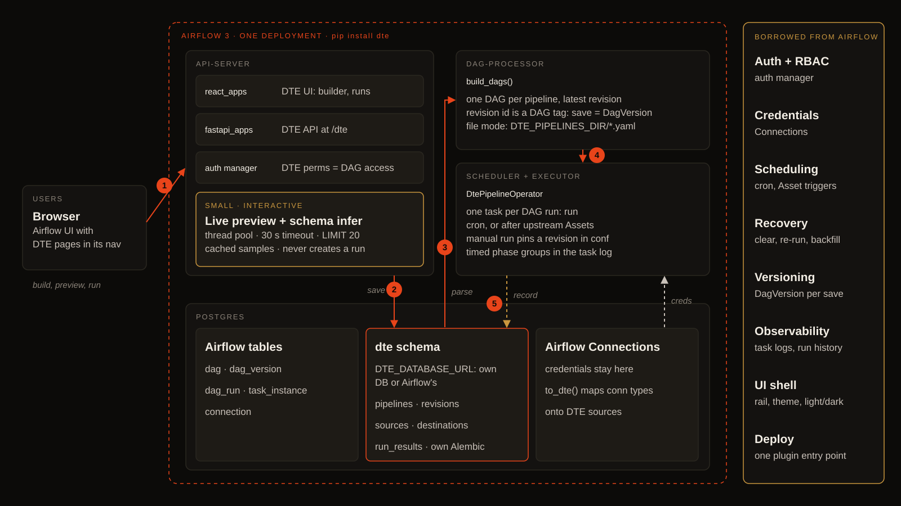
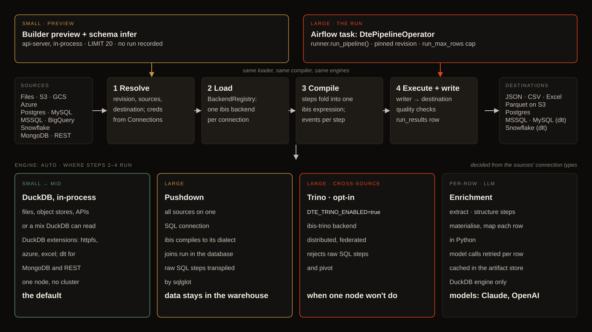

# DTE Architecture

This document describes how the Data Transformation Engine (DTE) is put together. It is aimed at engineers evaluating the project or joining the team, and at reviewers who want to understand the shape of the system without reading the whole codebase. Agent-facing conventions and workflow rules live in `CLAUDE.md`; roadmap and status live under `plans/`.

## Overview

DTE is a batch data transformation engine. A user defines a **Pipeline** — one or more sources, an ordered list of transform steps, and a destination — and the engine executes it end-to-end against DuckDB, streaming rows through Ibis expressions and writing the result to a file or a database. The product is aimed at data engineers and analytics teams who want a single, versioned specification for "how does raw source X become curated output Y", without operating a distributed cluster or writing bespoke Python for every new pipeline.

The engine is deliberately embedded and single-node today. DuckDB is the runtime; Ibis is the expression language; dlt handles a small number of API-shaped sources where its pagination and normalisation earn their keep. Everything else — filesystem globs, SQL databases, cloud object stores — goes through DuckDB extensions directly, because that is significantly faster and involves fewer moving parts than routing through dlt.

The UI is a React app, rendered natively inside Airflow as a plugin, that lets users compose pipelines visually, preview them against sample rows, and monitor runs. The backend is a FastAPI service backed by Postgres. Everything ships together in a Docker Compose stack.

## Runtime: DTE inside Airflow

### Deployment



DTE has no server of its own. It ships as one Airflow plugin (`pip install`, one entry point) and runs on the components an Airflow 3 deployment already has:

1. **api-server.** The plugin mounts the React UI as a native `react_apps` page and the FastAPI app at `/dte`. Airflow's auth manager answers DTE's permission checks. Live preview and schema inference run here, never create a run, and go through `run_interactive` (`dte/api/interactive.py`): a dedicated thread pool (`DTE_INTERACTIVE_CONCURRENCY`, 4) so a slow source can't stall Airflow's own routes, and a 504 after `DTE_PREVIEW_TIMEOUT_SECONDS` (30).
2. **Save.** Every save writes a new revision to the `dte` schema of the Postgres `DTE_DATABASE_URL` names: its own database, or Airflow's metadata database (own Alembic history). With `DTE_PIPELINE_STORE=file` pipelines are `DTE_PIPELINES_DIR/*.yaml` files instead.
3. **dag-processor.** `build_dags()` (`dte/airflow/dag_factory.py`) reads the latest revision of every pipeline and builds one `dte__<id>` DAG each. The revision id is a DAG tag, so every save is a new DagVersion; an enabled schedule becomes the DAG's cron, or an after-upstream schedule waits on other pipelines' output Assets.
4. **scheduler + executor.** Each DAG has one task, `run`, a `DtePipelineOperator` (`dte/airflow/operators.py`). It resolves the pinned revision, sources and destination, and takes credentials from Airflow Connections through the `to_dte()` adapter.
5. **Record.** The task writes a `run_results` row (rows written, SQL, quality results); status, timings and logs are Airflow's own.

### Execution



Preview and a run share the compiler and engines; they differ in what they read. `runner.run_pipeline()` (`dte/airflow/runner.py`) resolves the revision and its sources, loads each source live through `BackendRegistry` (one ibis backend per connection), compiles the steps to one ibis expression, runs `pre` quality contracts (a failing one writes nothing), then executes, writes and runs `post` contracts.

The builder's preview (`POST /pipelines/dry-run`, debounced on each edit, `LIMIT 20`) loads through `sample.load_interactive` instead: lazy sources (files, object stores, other databases) pass straight through, while eager sources (REST, MongoDB) and metered ones (BigQuery, Snowflake tables) are read from a cached parquet sample (`DTE_SAMPLE_ROWS`, 1,000) under `$DTE_ARTIFACT_DIR/samples`, so steps on a warehouse sample run in DuckDB for free. A metered preview fires on click, not on every edit. Preview on live data, and a run of a metered pipeline, are priced first (BigQuery dry run, Snowflake `EXPLAIN`); above the connection's threshold the API returns the estimate and runs nothing until `confirm=true`, and a byte cap or statement timeout on the connection refuses what's too big. `engine: auto` (`resolve_pipeline_engine`) decides where the work runs from the sources' connection types:

- **DuckDB, in-process** for files, object stores and APIs, or any mix DuckDB can read. One node, no cluster. The default.
- **Pushdown** when every source sits on one SQL connection: ibis compiles to that database's dialect, joins run in the database, raw SQL steps are transpiled by sqlglot.
- **Trino**, opt-in with `DTE_TRINO_ENABLED=true`, for large cross-source work. Rejects raw SQL steps and pivot.
- **Enrichment** (extract, structure, http_lookup) is the one per-row Python seam: it materialises, maps each row through a model or HTTP call and caches results in the artifact store. DuckDB engine only.

## Data flow

A pipeline run flows through five hops:

```
Source configs (Pipeline.sources: [id, id, ...])
    |
    v
SourceStore.get(id)  -->  Source model
    |
    v
loader.load_source(source, registry, connection, credentials)  -->  ibis.Table per source
    |                                       (the run's DuckDB connection, or the source DB for pushdown)
    v
compile_pipeline(pipeline, tables, output)  -->  ibis.Table (transformed)
    |
    v
pre-phase quality contracts  -->  failed_quality, nothing written
    |
    v
DuckDBEngine.execute(table, target)  -->  writer  -->  output file / DB
    |
    v
RunStore.update(status, rows_written, finished_at)
```

Each hop has a single responsibility:

1. **Resolve.** The API route looks up every source id in `SourceStore` and the destination id in `DestinationStore`. A missing id returns 422 naming what was missing before any execution starts.
2. **Load.** `dte.sources.loader.load_source(source, registry, connection, credentials)` returns an `ibis.Table`. `BackendRegistry` hands out the run's one DuckDB connection, or one native ibis backend per SQL connection so the query can push down.
3. **Compile.** `compile_pipeline` walks the ordered step list, dispatches on `op` (and `mode` for `map` steps), and returns a single `ibis.Table` representing the final projection. The compiler never executes — it only builds an expression tree.
4. **Execute.** `DuckDBEngine.execute(table, target)` hands the expression to the appropriate writer under `dte/engine/writers/`. Writers own how bytes hit disk / the target database, including format-specific concerns like the DuckDB `excel` extension or the JSON `default=str` decimal coercion.
5. **Record.** The API route persists the row count, terminal status, and (via a Postgres trigger) `finished_at`. Per-step events are captured through the compiler's `on_step` callback so the future `Timeline` UI has data to render.

## API surface

The HTTP API is a thin CRUD layer over the stores, plus two execution endpoints (`trigger`, `preview`) and one inspection endpoint (`schema/infer`). All routes are gated by JWT auth at the router level; only `/api/health` and `/api/auth/*` are open.

```
POST   /api/pipelines                     create pipeline (validates source/dest ids exist)
GET    /api/pipelines                     list pipelines
GET    /api/pipelines/{id}                get pipeline
PUT    /api/pipelines/{id}                update pipeline
DELETE /api/pipelines/{id}                delete pipeline
POST   /api/pipelines/{id}/trigger        start async run -> {run_id}
GET    /api/pipelines/{id}/preview?limit  compile + execute on sample rows
GET    /api/pipelines/{id}/runs?limit     run history per pipeline
GET    /api/runs/{run_id}                 poll run status
GET    /api/runs/{run_id}/output?limit    peek at the run's output file
GET    /api/runs/{run_id}/events          per-step events for the Timeline UI
POST   /api/schema/infer                  field tree from an in-flight Source body
POST   /api/sources                       create source (409 on id collision)
GET    /api/sources                       list sources
GET    /api/sources/{id}                  get source
PUT    /api/sources/{id}                  update source
DELETE /api/sources/{id}                  409 with {referenced_by: [...]} if any pipeline uses it
GET    /api/sources/{id}/schema           field tree for a saved source (id-only)
POST   /api/destinations                  create destination
GET    /api/destinations                  list / read / update / delete destinations
GET    /api/connections                   Airflow connections DTE can map (read-only; manage them in Airflow)
GET    /api/connections/{id}              read (credentials masked)
POST   /api/connections/{id}/test         connectivity probe -> {ok, elapsed_ms, detail}
```

Delete endpoints are protective: they return 409 with a `referenced_by` payload if anything else in the system points at the entity, so a user cannot accidentally orphan a pipeline by deleting its source.

## Core concepts

### Pipeline

A `Pipeline` is a Pydantic model with three top-level fields: `sources: list[str]` (source ids), `steps: list[dict]` (ordered transforms), and `output_id: str` (destination id). Pipelines carry no credentials and no file paths of their own — everything lives in the entities they reference.

Steps are a typed discriminated union, `Step` (plan 088), with a callable discriminator so `map`'s `mode` can split one `op` into two classes. Writes validate against it and against `ALLOWED_OPS` for the pipeline type; the stored value stays the dict that was sent, and reads are lenient (an unknown op loads as `UnknownStep`). Each step class compiles itself.

### Source

A `Source` describes _where_ data comes from and _which slice_ of it to read. Fields: `id`, `source_type`, `config` (kind-specific dict), `table`, `format`. It references a `Connection` for credentials. `source_type` is a strict `Literal` (`filesystem`, `s3`, `gcs`, `azure`, `sql_database`, `mongodb`, `rest_api`) so unknown values are rejected at the API edge.

### Destination

A `Destination` wraps an `OutputTarget` — a Pydantic discriminated union over `type` with six variants: `json_file`, `csv_file`, `excel_file`, `parquet_s3`, `postgres`, `sql_database`. File-shaped targets validate that the on-disk extension matches the target family (a `json_file` at `orders.csv` is rejected at save).

### Connection

Credentials are separated from the entities that use them:

```
Connection (credentials only)
    ^
    |
Source / Destination (references connection_id + carries the "where inside the target" bits)
    ^
    |
Pipeline (references source ids + destination id)
```

A Connection is an Airflow Connection: `connection_id` is an Airflow `conn_id`, and DTE stores no credentials (plan 091 removed the last of the encrypted-credential code). Local file targets use an Airflow `fs` connection. Compatibility maps (`SOURCE_CONNECTION_COMPAT`, `DESTINATION_CONNECTION_COMPAT`) reject impossible pairings such as an s3 source bound to a postgres connection with a 422.

### Run

A `Run` records one execution of a pipeline. Fields: `id`, `pipeline_id`, `status` (`pending` / `running` / `completed` / `failed`), `error`, `rows_written`, `started_at`, `finished_at`. Terminal transitions stamp `finished_at` via a Postgres `BEFORE UPDATE` trigger installed by migration `003`, so the API code never has to remember to set it.

### Step ops

The compiler dispatches on `op`:

- `filter` — SQL predicate applied via a raw-SQL escape hatch.
- `rename` — column renames (Ibis's rename direction is `{new: old}`, opposite of intuition).
- `retype` — column type casts routed through `_TYPE_MAP`.
- `map` — synthesises a new column. Three modes: `lookup` (join to a `LookupTable`), `expression` (raw SQL fragment), `calculation` (Ibis arithmetic).
- `sort` — ordering, with optional per-column direction.
- `aggregate` — group-by with an aggregation list.
- `join` — multi-source combination; writes into the registry under `output_id`.
- `pivot` — DuckDB dynamic PIVOT, materialised as a TEMP TABLE (see compiler notes).
- `select` — final projection, with keep/drop semantics.

## Module layout

```
backend/dte/
    api/         FastAPI routes, dependency wiring, error handlers, middleware
    compiler/    ibis_compiler.py — pipeline -> ibis.Table
    models/      pipeline.py — Pydantic + SQLModel two-class models
    store/       Protocols in base.py; PostgresStore implementations in postgres.py
    sources/     loader.py — dispatch by source_type; connection_test.py — probes
    engine/      duckdb_engine.py + writers/ — expression -> output
    security/    JWT, password hashing, permission checks
    schema/      Schema inference for the field-picker UI
    admin/       Optional FastAdmin mount at /admin
    runs.py      Background run execution wrapper (guardrails)
```

`config.py`, `errors.py`, `logging.py`, and `tracing.py` sit at the package root. Alembic lives in `backend/alembic/`. Tests are `backend/tests/{unit,integration,scenarios}/`.

## Compiler design

`compile_pipeline(pipeline, tables, output=None, lookup_tables=None, on_step=None)` maintains a **named registry** — `dict[str, ibis.Table]` — rather than a rolling variable. Each step reads from and writes back to the registry via `current_key`. Join steps write their result under `output_id` and update `current_key`. This model naturally supports multi-source pipelines: sources start out in the registry keyed by their id; a join fuses two of them under a new key; subsequent single-table steps operate on that key.

Dispatch is a plain `if op == "join"` / `else` branch. Non-join ops route through `_dispatch_single_table_step(table, step, lookups)`, which parses the step dict into the right op-specific Pydantic model (`FilterStep`, `RenameStep`, `RetypeStep`, `LookupMapStep`, `ExpressionMapStep`, etc.) and calls the corresponding `_apply_*` function.

Two ops escape to raw SQL because Ibis has no SQL string parser:

- `filter` and expression-mode `map` write the current table as a view (`con.create_view("_filter_input", table, overwrite=True)`) and then `con.sql(f"SELECT * FROM _filter_input WHERE {expr}")`. This is the seam through which raw predicate SQL enters the expression tree. Future distributed backends (Spark, Trino) would plug in here.
- `pivot` uses `con.con.execute("CREATE OR REPLACE TEMP TABLE ... AS PIVOT ...")`. Dynamic PIVOT cannot be a view in DuckDB, and `con.sql()` fails because sqlglot cannot subquery a PIVOT node.

Field references use dot syntax on the wire: `order.amount`, `user.address.city`. `_resolve_field()` splits on `.` and traverses STRUCT members. If the head isn't a top-level column it falls back to the joined `__` name, so `mongodb` / `rest_api` sources — which still flatten via dlt — keep working. Legacy `parent__child` references are auto-normalised on read; a script in `backend/scripts/migrate_field_refs.py` migrates saved pipelines persistently.

Ibis version notes worth pinning down before touching the compiler:

- ibis >= 9 uses `ibis.cases(*[(cond, val), ...], else_=default)`, not `ibis.case()`.
- `table.rename({new_name: old_name})` is reversed from most people's expectation.

The compiler accepts an optional `on_step(idx, op, status, message=None)` callback. It is invoked with `status="started"` before each step and `"completed"` / `"failed"` after. This is how per-step run events are recorded without threading async into the compiler; the callback is wrapped in a try/except so telemetry failures never crash a run.

## Source loading

`dte.sources.loader.load_source(source, registry, connection, credentials)` dispatches on `source.source_type` through `LOADERS`. Not every source goes through dlt — the choice is deliberate:

- **`filesystem`** — DuckDB TVFs. `read_json_auto` / `read_csv_auto` / `read_parquet` / `read_xlsx`, materialised via `CREATE OR REPLACE VIEW`. No dlt. Nested JSON comes through as native STRUCT columns. Format is detected by extension (`.json`, `.jsonl`, `.ndjson`, `.csv`, `.tsv`, `.parquet`, `.xlsx`); `config["format"]` overrides. `.xlsx` uses the `excel` extension (lazy `INSTALL excel; LOAD excel;`) and reads only the first sheet.
- **`sql_database`** — DuckDB scanner extensions. `INSTALL sqlite|postgres|mysql; ATTACH ... (TYPE ..., READ_ONLY); CREATE VIEW`. Scheme detected from the SQLAlchemy-style credentials URL. No dlt.
- **`s3`, `gcs`, `azure`** — DuckDB native remote reads. `s3` and `gcs` go through the `httpfs` extension; `azure` through the `azure` extension. Each loader installs the extension, emits `CREATE OR REPLACE SECRET <scoped-name> (TYPE ..., ...)`, then materialises `bucket_url + file_glob` via `read_*_auto` in a view. GCS auth is HMAC-only. Azure accepts a connection string (preferred) or account name + key.
- **`mongodb`, `rest_api`** — dlt (`@dlt.resource` + `dlt.sources.rest_api.rest_api_source`). Kept because dlt's pagination and normalisation earn their keep for real APIs. Columns come through with `__` flattening.

The single-connection rule matters: every loader must attach or create a view on the DuckDB connection the engine already holds. Two connections cannot see each other's views, so a source loaded on a fresh connection is invisible to the compiler.

## Persistence

DTE is **Postgres-only** in production. `DATABASE_URL` must be set; the dependency getters in `dte/api/deps.py` raise `RuntimeError` if it is missing. There is no in-memory store shipped in the package. Tests inject `Fake*Store` implementations from `tests/fakes.py` via `app.dependency_overrides`.

Under Docker Compose the backend service runs `alembic upgrade head` (using a synced URL derived by stripping `+asyncpg`) and then execs uvicorn. Pipelines and runs survive `docker compose restart` via the `pgdata` volume.

### Store protocols

`dte/store/base.py` defines a `Protocol` for each persisted entity: `PipelineStore`, `SourceStore`, `DestinationStore`, `ConnectionStore`, `LookupTableStore`, `RunStore`, `RunEventStore`, `UserStore`, `RoleStore`. The one production backend implementing them all is `postgres.py`. The active backend is wired in `dte/api/deps.py` and injected into routes via FastAPI `Depends()`. Stores hold a session factory (not a live session) so the singleton is safe across FastAPI requests and the background `asyncio.create_task` in `trigger_pipeline`.

### Model + store pattern (SQLModel)

Every Pydantic-modelled persisted entity — `Pipeline`, `Source`, `Destination`, `Connection`, `LookupTable`, `User` — is a two-class pair in `dte/models/pipeline.py`:

- `XxxBase(SQLModel)` — API/domain fields, Pydantic validators, and strict Literal types (`ConnectionType`, `SourceKind`) that reject unknown values at the edge. Routes bind POST/PUT bodies to `XxxBase`.
- `Xxx(XxxBase, table=True)` — persistence identity (primary key, timestamp columns) with Literals overridden to plain `str` because SQLModel 0.0.39 cannot map `Literal` to a SQLAlchemy column. Stores save and return typed `Xxx` instances.

`table=True` construction skips Pydantic validators. Any hydrated instance that needs post-load narrowing (e.g. `Destination.config` narrowed from raw JSONB to the discriminated `OutputTarget` union) calls an explicit method that uses `TypeAdapter(...).validate_python(...)` and `object.__setattr__` to bypass SA instrumentation.

Every `Postgres*Store` (except `PostgresRunStore`, which still hand-writes SQL) uses the same three-verb ORM template: `session.get(Xxx, id)` for reads, `pg_insert(Xxx).on_conflict_do_update(...)` for saves (`session.merge` will not fire the `updated_at` `onupdate` server default), and `select(Xxx).order_by(Xxx.created_at.desc())` for lists.

### Secrets

DTE stores no credentials. Connections are Airflow Connections, read through `dte/airflow/connections.py`; secrets live wherever Airflow's secrets backend keeps them.

### Migrations

Alembic. `DATABASE_URL` must be a sync driver (e.g. `postgresql://`) for migrations; asyncpg is stripped when the compose command runs `alembic upgrade head`. Migrations live in `backend/alembic/versions/`; each numbered file corresponds to one shape change. Notable migrations:

- `003` — installs the `runs.finished_at` `BEFORE UPDATE` trigger.
- `004` — first-class `sources` and `destinations` tables.
- `009` — `sources.format` column for filesystem-family reader override.

One-off data migrations (rather than schema migrations) live under `backend/scripts/`. They are idempotent by convention: `migrate_field_refs.py` rewrites `parent__child` field references to dot syntax; `migrate_embedded_endpoints.py` splits pipelines with embedded source/destination configs into the three-tier model.

## Execution and observability

`POST /api/pipelines/{id}/trigger` returns a `run_id` immediately. The heavy lifting runs as an `asyncio.create_task` — the caller polls `GET /api/runs/{run_id}` until `status` reaches `completed` or `failed`. The background task is the point at which guardrails (max-rows, timeout, cancellation) attach.

Structured logging is configured in `dte.logging`. Every request goes through `RequestContextMiddleware`, which binds a request id into the log record. Runs log with their `run_id` so log queries filter cleanly.

Tracing is opt-in via `DTE_TRACING_ENABLED=1`. When enabled, `configure_tracing()` wires OpenTelemetry and `FastAPIInstrumentor.instrument_app(app)` auto-instruments the HTTP layer. The compiler's `on_step` callback is the seam for per-step spans; the current implementation persists step events through `RunEventStore` but does not yet emit spans.

Per-step events are recorded in the `run_events` table via `RunEventStore.record`, keyed on `(run_id, step_index)`. The frontend `Timeline` component reads these through `/api/runs/{id}/events`. The `finished_at` column on `runs` is not set by the API code — a `BEFORE UPDATE` trigger from migration `003` stamps it when `status` transitions to `completed` or `failed`. Adding a new terminal status means extending both the trigger and any fake stores that mirror the rule.

### Guardrails

Long-running pipelines are constrained by three levers, applied in `dte/runs.py` around the compile/execute call:

- **Timeout.** A per-run wall-clock deadline; exceeding it cancels the underlying task and marks the run `failed` with a timeout error.
- **Max rows.** A hard cap on rows written before the writer aborts. Prevents a mis-configured `join` from filling a disk.
- **Cancellation.** `asyncio.CancelledError` from the task is caught, translated into a `failed` status with a cancellation message, and any partial output is cleaned up.

Guardrails default off in dev but are wired to environment / settings knobs so production deployments can turn them on without code changes.

### Preview

`GET /api/pipelines/{id}/preview?limit=N` is the interactive-debugging seam. It resolves sources and destination like `trigger`, runs `compile_pipeline`, and executes with a `LIMIT` pushed onto the final expression. It writes to a temp path (not the real destination), returns the sample rows inline, and never records a `Run`. Compile-time errors — the most common class of pipeline bug — surface here in a fraction of a second, which is much faster than the trigger/poll loop.

## Frontend

The UI lives under `frontend/` — React 19, Tailwind v4, pnpm, built by Vite into one Airflow `react_apps` bundle (plan 066). Airflow renders it inside its own page with its shared React and router, so DTE takes Airflow's theme, fonts and light/dark mode. Pages live in `src/pages/` and the route table in `src/plugin.tsx`. Data fetching is SWR-based, with a hand-written `apiFetch<T>` wrapper over a generated `api-types.ts` (regenerated from the backend's `/openapi.json`). Run pages poll `/api/runs/{id}` every 2s until the run is terminal, then stop.

The design system in `src/components/ui/` is intentionally self-contained (imports only itself and a `cn.ts` helper) so it can be ported to other projects. DTE-specific composition lives in `src/components/builder/`. The full frontend playbook — server-vs-client discipline, the `FieldPicker` portal, the discriminated `output` union, step editors — is documented in `CLAUDE.md` and `frontend/AGENTS.md`.

## Testing tiers

The backend test suite is layered so contributors run only what the change touches:

- **Unit** (`backend/tests/unit/`) — compiler and model tests. No HTTP, no I/O, no database. Collected by default `pytest`. Fast enough to run on every save.
- **Integration** (`backend/tests/integration/`) — hits real Postgres via `DATABASE_URL`; auto-skips when unset. Marker: `integration`. These are the tests that exercise `on_conflict_do_update` semantics, the `finished_at` trigger, and the JSONB round-trip.
- **Scenarios** (`backend/tests/scenarios/`) — end-to-end user flows over the real HTTP API using `httpx.AsyncClient(ASGITransport)`. One file per step op under `steps/`, plus error paths, nested fields, and preview coverage. Marker: `scenario`. Excluded from the default run via `addopts = "--ignore=tests/scenarios"` in `pyproject.toml`; opt in with `pytest tests/scenarios -m scenario`.

Scenario tests use a small DSL in `tests/scenarios/helpers.py` (`create_connection`, `create_source`, `create_destination`, `create_pipeline`, `trigger_and_wait`, `read_output_file`) and hand-crafted deterministic fixtures (`orders.json`, `products.json`, etc.) so assertions can be exact row-set comparisons rather than fuzzy shape checks.

## Non-goals

DTE deliberately does not:

- **Stream.** Everything is batch. Real-time / CDC / streaming ingestion is a P4 concern in the roadmap and would require a different execution model — likely a separate service, not a compiler variant.
- **Distribute.** Single-node DuckDB is the runtime. Scaling to Spark / Trino / a warehouse is a P2 concern; the raw-SQL escape hatches in the compiler are where a distributed backend would eventually plug in.
- **Ship a plugin marketplace.** New source and destination kinds are code changes: a `SourceKind` literal, a loader dispatch, a compatibility map entry, an editor in the builder. This is a conscious choice — every integration is code-reviewed and tested.
- **Orchestrate.** Airflow does: a schedule is the DAG's cron, or Airflow Assets ("after upstream", plan 089) for chaining pipelines.
- **Version pipelines automatically.** Pipelines are Pydantic models stored in Postgres. Change history is a P1 / P2 concern; today, edits overwrite.

## Deployment

The reference deployment is Docker Compose: a Postgres container, a backend container running uvicorn against `dte.api.main:app`, and a frontend container running `pnpm dev` (in dev) or a Next production build (in prod). Ports are `3000` for the frontend, `8001` for the backend, and `5432` for Postgres.

Dev mode mounts `./backend/dte` and `./backend/alembic` into the backend container and `./frontend` into the frontend container, so both sides hot-reload. Production images are built from the same Dockerfiles with dev volumes stripped. The backend service runs `alembic upgrade head` before execing uvicorn, so a fresh database self-migrates on first boot.

Settings are read from `DTE_*` environment variables (`dte/config.py`). Tracing is opt-in via `DTE_TRACING_ENABLED=1`.

### Running inside Airflow (plan 065)

DTE is an Airflow 3.3 app; there is no standalone mode. Everything lives in `dte/airflow/`:

- **Plugin** (`plugin.py`) mounts the FastAPI app at `/dte` in the Airflow api-server and registers the UI bundle (`/dte/ui/dte.umd.js`) as `react_apps` nav entries. Auth is Airflow's: `auth.py` resolves the caller from Airflow's token or session cookie and derives DTE permissions from Airflow DAG access.
- **DAG factory** (`dag_factory.py`, loaded by `dags/dte_dags.py`) reads the `dte` schema at parse time: one DAG `dte__<pipeline>` per pipeline, built from its latest revision, with the pipeline's single schedule (if enabled) as a cron timetable or a list of upstream Assets. The run task declares its sources and destination as Asset inlets/outlets, and `max_active_runs=1` unless the schedule allows overlap. With `DTE_PIPELINE_STORE=file` (plan 090) it reads `DTE_PIPELINES_DIR/*.yaml` instead of the database. The revision id is a DAG tag (`dte-revision:<id>`), so pipeline revision = DAG version (plan 068); the operator runs the revision the dag run pins (`conf.revision_id`, else the DAG's own), and the trigger waits for the DAG version carrying it.
- **Operator** (`operators.py`) loads the pipeline, resolves sources/destination through Airflow Connections (`connections.py` maps Airflow conn types onto DTE's), and calls `runner.run_pipeline`. A `fail` quality check fails the task. It writes one `run_results` row per dag run.
- **Runs**: `POST /trigger` validates, then creates a dag run through Airflow's REST API with the caller's credentials. Run history is Airflow's `dag_run` joined to `run_results`.
- **Storage**: DTE's tables sit in a `dte` schema inside Airflow's metadata DB, migrated by `dte db upgrade` with its own alembic version table.

Runs are never auto-retried — they aren't idempotent against a destination. See `docs/user/self-hosting/scaling.md` for the operator-facing version.

## Where to look next

- **`CLAUDE.md`** — day-to-day conventions, coding rules, test tiers, worktree workflow. Read this before making a code change.
- **`plans/`** — numbered design docs. One per feature. Every non-trivial change starts here.
- **`plans/027-p0-p4-status-ladder.md`** — the current P0-through-P4 roadmap and honest status ladder.
- **`backend/tests/scenarios/`** — end-to-end user flows over the real HTTP API. The best place to see what the engine actually does with a given pipeline shape.
