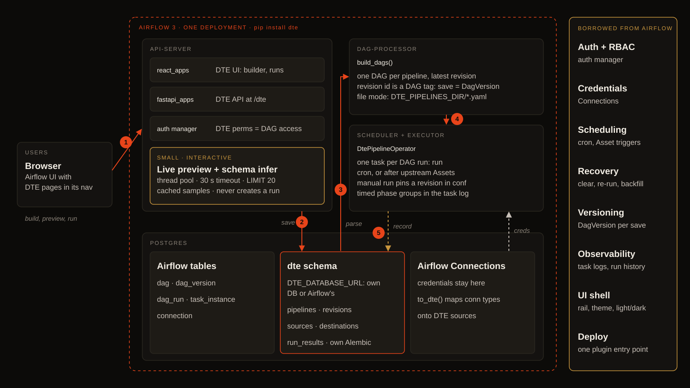
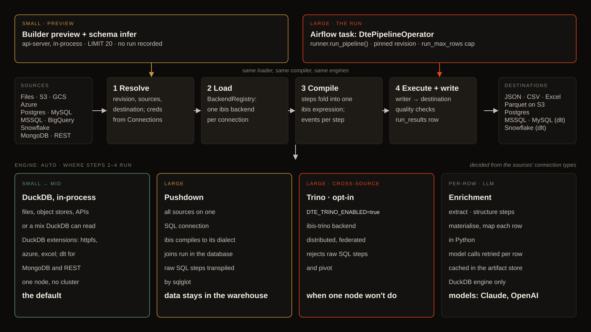

# Architecture overview

What runs where. Full version: [`ARCHITECTURE.md`](https://github.com/flowexperts/dte-airflow/blob/main/ARCHITECTURE.md).

## It's an Airflow plugin

dte has no server of its own. One package, `dte-airflow`, installed on every Airflow component, adds:

- An API on Airflow's api-server at `/dte/api`: pipelines, sources, destinations, preview, schema inference.
- A UI, a `react_apps` plugin rendered natively at `/plugin/dte`, in Airflow's theme and left rail.
- A DAG factory, the one-line `dte_dags.py` in your DAGs folder. It turns every pipeline into a `dte__<pipeline id>` DAG.
- An operator, `DtePipelineOperator`, which runs a pipeline as an Airflow task.

Airflow owns login, permissions, connections, scheduling and run history.

## The execution stack

- ibis is the compiler DSL. Each step maps to an ibis operation, stitched into one query.
- DuckDB is the in-process query engine. A pipeline whose sources are all in one database can push the query down to it instead.
- dlt handles `mongodb` and `rest_api` sources, plus some database writes.

DuckDB reads local files directly. S3, GCS, Azure and SFTP go through the provider's fsspec filesystem (`ObjectStoragePath`), so the provider does the auth. SQL sources open with ibis, using the URL from the provider hook.

## Where credentials live

In Airflow: the metadata DB, `AIRFLOW_CONN_*` variables or a secrets backend. dte resolves them at run time through `BaseHook.get_connection`. Sources and destinations hold a connection id plus the "where inside" details (bucket, table, path). See [Secrets & environment](../self-hosting/secrets.md).

## Storage layout

- Postgres: dte's tables (`pipelines`, `sources`, `destinations`, `lookup_tables`, `run_results`…) in a `dte` schema of the database `DTE_DATABASE_URL` names. Its own database (recommended) or Airflow's metadata database. The api-server reads dag runs through Airflow and merges them with `run_results`.
- `DTE_ARTIFACT_DIR`: cached document extractions and model calls. Share it across components.
- In-process: an ephemeral DuckDB connection per run.

## How a run happens

1. A user clicks **▶ Run**, or the schedule fires.
2. For a manual run, dte's API asks Airflow's REST API to trigger `dte__<pipeline id>`, forwarding the user's credentials so Airflow's permissions apply.
3. The scheduler queues the dag run and an executor runs `DtePipelineOperator`, which:
   - Loads the revision the run started against, with its sources and destination
   - Resolves their connections through Airflow
   - Loads each source into the run's DuckDB connection
   - Compiles the steps into one ibis expression, executes it, writes to the destination
4. The outcome (status, rows written, quality results, SQL that ran) goes into `dte.run_results`, keyed by dag run id. Airflow keeps the task state and log.
5. The UI polls the run every 2 seconds until it finishes.

More: [Data flow](data-flow.md), [`plans/`](https://github.com/flowexperts/dte-airflow/tree/main/plans).
