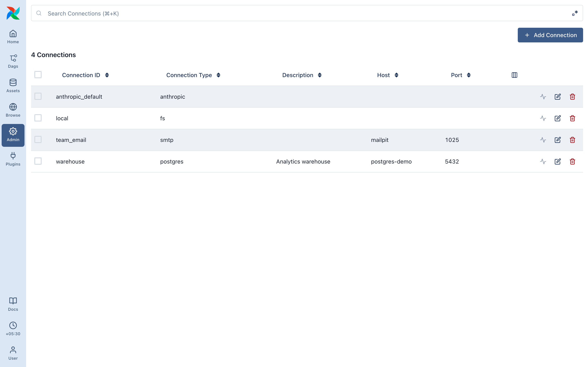

# Connections

A connection holds credentials for one system: a database, a bucket, an API. It doesn't know which table or folder.

dte has no connections of its own. It uses **Airflow connections**, and the provider that owns each type does the auth. Create them in **Admin → Connections**, in `AIRFLOW_CONN_*` environment variables, or in a secrets backend.

Sources and destinations point at a connection by name, so rotating credentials is one change, and anything that works in an Airflow task (IAM role, Azure service principal, GCP service account) works in dte.

## Every connection type

dte offers a type only when its provider is installed. Others show in the source picker as disabled, with the package to install.

| Airflow connection type | Provider package | Use it for |
| ----------------------- | ---------------- | ---------- |
| `fs` | `apache-airflow-providers-standard` | Files on the machines Airflow runs on |
| `aws` | `apache-airflow-providers-amazon[s3fs]` | Reading and writing S3 (and S3-compatible stores: set `endpoint_url` in the extra) |
| `google_cloud_platform` | `apache-airflow-providers-google` | Reading and writing GCS. Set extra `dte_type: bigquery` to use it for BigQuery instead |
| `gcpbigquery` | `apache-airflow-providers-google` | Reading and writing BigQuery. See the [BigQuery guide](../sources/bigquery.md) for credentials and the `dte_max_bytes_billed` spending cap |
| `wasb`, `adls`, `azure_data_lake` | `apache-airflow-providers-microsoft-azure` | Reading and writing Azure Blob / ADLS |
| `sftp` | `apache-airflow-providers-sftp` + `sshfs` | Reading and writing files over SFTP |
| `postgres` | `apache-airflow-providers-postgres` | Reading and writing tables |
| `mysql` | `apache-airflow-providers-mysql` | Reading and writing tables |
| `mssql` | `apache-airflow-providers-microsoft-mssql` | Reading and writing tables (needs Microsoft ODBC Driver 18) |
| `snowflake` | `apache-airflow-providers-snowflake` | Reading and writing tables ([setup and cost](snowflake.md)) |
| `sqlite` | `apache-airflow-providers-sqlite` | Reading local `.db` files |
| `mongo` | `apache-airflow-providers-mongo` | Reading collections |
| `http` | `apache-airflow-providers-http` | Pulling data from a JSON API (login/password become basic or bearer auth) |
| `kafka` | `apache-airflow-providers-apache-kafka` | Reading topics. The extra is the Kafka client config (`bootstrap.servers`, SASL…), see the [Kafka guide](../sources/kafka.md) |

Fill each in as the provider documents it. dte reads SQL connections through the hook's SQLAlchemy URL (Snowflake through the hook itself, so key-pair and OAuth auth work) and opens files through the provider's filesystem.

## Which connections dte lists

The picker lists the metadata database and `AIRFLOW_CONN_*` variables. A secrets backend can't be enumerated: its connections resolve at run time but don't appear in the picker, so set `connection_id` on the source or destination through the API.

## Test

**Test** calls the provider's own connection test. Airflow disables it by default; enable with `[core] test_connection = Enabled` (`AIRFLOW__CORE__TEST_CONNECTION=Enabled`). A failure shows the provider's message.

## Connection and source / destination pairs

dte rejects mismatched pairs at save.

- `fs` → filesystem sources; JSON, CSV, Excel, Parquet file destinations
- `aws`, `google_cloud_platform`, `wasb`/`adls`, `sftp` → the matching file source (S3, GCS, Azure, SFTP); JSON, CSV, Excel, Parquet file destinations at a matching URL
- `postgres` → SQL database sources; PostgreSQL destinations
- `mysql`, `mssql`, `snowflake`, `gcpbigquery` (or `google_cloud_platform` with `dte_type: bigquery`) → SQL database sources; SQL database destinations
- `sqlite` → SQL database sources (read only)
- `mongo` → MongoDB sources
- `http` → REST API sources
- `kafka` → Kafka sources
