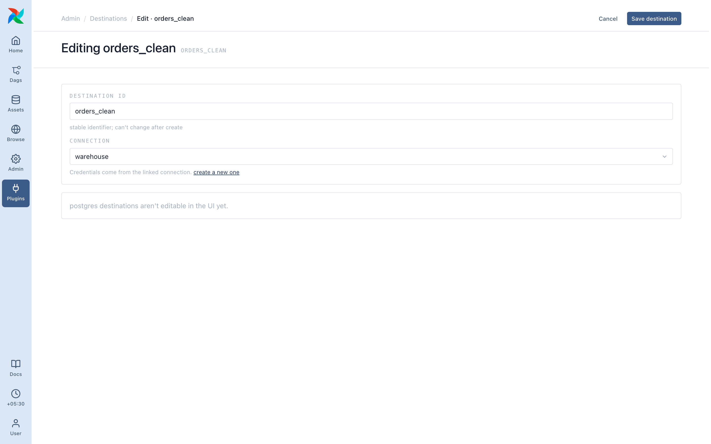

# Destinations

A destination is where a pipeline's result lands.

## Every destination type

| Type | Writes to | What you fill in |
| ---- | --------- | ---------------- |
| **JSON file** | A `.json`, `.jsonl`, or `.ndjson` file | Path, optional field list |
| **CSV file** | A `.csv` or `.tsv` | Path, optional field list |
| **Excel file** | An `.xlsx` (first sheet) | Path, optional field list |
| **Parquet file** | A `.parquet` file | Path |
| **PostgreSQL** | A Postgres table | Schema, table, write mode |
| **SQL database** | A table in MySQL, SQL Server, Snowflake, or BigQuery | Dialect, schema, table, write mode |

File destinations write locally (an `fs` connection) or to object storage: `s3://bucket/out/orders.parquet`, `gs://…`, `az://…` or `sftp:///path/…`, with the matching `aws`, `google_cloud_platform`, `wasb`/`adls` or `sftp` connection.

The path extension must match the type (`orders.csv` on a JSON destination is rejected at save). Same-family extensions are fine: `.json`, `.jsonl` and `.ndjson` all count as JSON.

## Field list (file destinations)

JSON, CSV and Excel destinations take an optional **fields** list. Empty writes every column. Filled in writes only those columns, in that order, optionally aliased:

| Field | Alias |
| ----- | ----- |
| `id` | *(none)* |
| `customer_name` | `customer` |
| `order.amount` | `amount` |

Nested paths work, see [Field names](../pipelines/field-refs.md). For SQL destinations, use a [**Select** step](../steps/index.md).

## Write mode (database destinations)

| Mode | What it does |
| ---- | ------------ |
| **Replace** | Empties the table and inserts. Default. |
| **Append** | Adds rows to what's there. |
| **Merge** | Updates rows matching the primary key, inserts the rest. Pipeline output must include the key column. |

## Builder editing

The pipeline builder edits **JSON file** destinations inline. For every other type, create it under **Destinations → New** and pick it by name. The placeholder card you see in the builder is expected.
