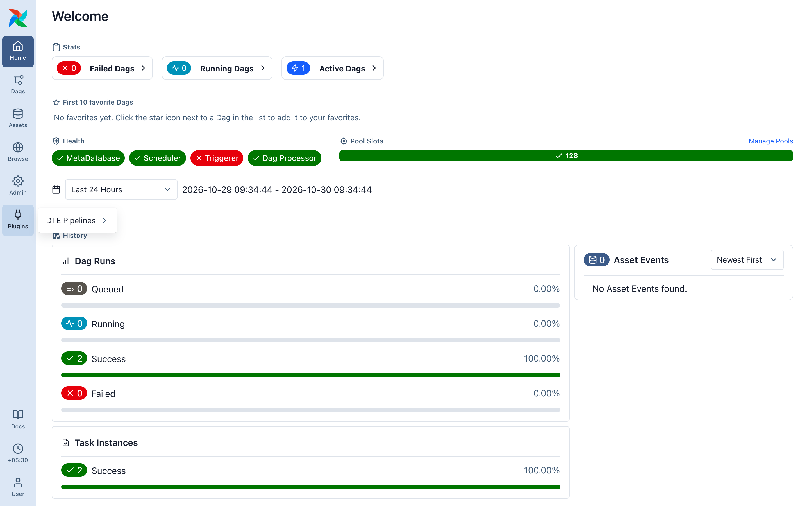

# Find dte in Airflow

dte has no login of its own. Sign in to Airflow as usual. Not installed yet? See [Install into your own Airflow](../self-hosting/install-plugin.md) or [Docker Compose](../self-hosting/install.md).

## Where it lives

- Plugins ▸ DTE Pipelines ▸ Transform: build, preview and run pipelines.
- Plugins ▸ DTE Pipelines ▸ Quality Check: pipelines that only check data and write nothing.
- Admin ▸ DTE Sources
- Admin ▸ DTE Destinations
- Admin ▸ DTE Lookup tables: small reference tables a pipeline can use.
- Admin ▸ Connections: Airflow's own. dte uses these for every database, bucket and API.

## Who can do what

Airflow decides. If you can see and trigger a `dte__…` DAG, you can see and run that pipeline.

Next: [Your first pipeline](02-first-pipeline.md)
