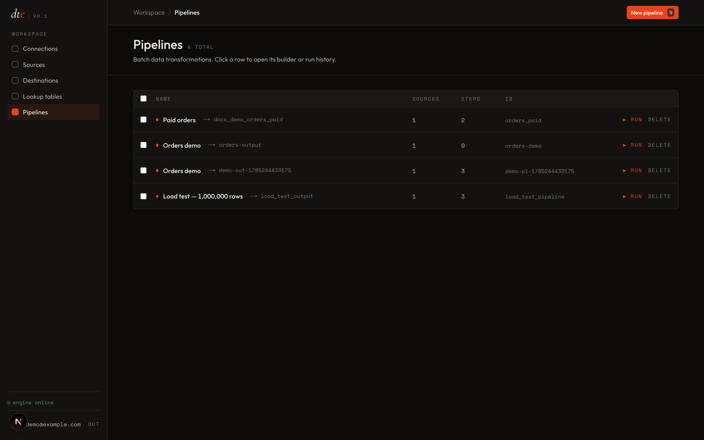

# Sign in

Open dte in your browser. If your team hosts it, you have a URL — something like `dte.your-company.com`. If you're running your own copy, see [Install into your own Airflow](../self-hosting/install-plugin.md).

## First time

- The first person to sign up on a fresh dte becomes the **admin**.
- Everyone after that signs up as a regular user.

Fill in email and password. You land on the **Pipelines** page. It's empty. That's expected — you haven't built one yet.

## The sidebar

From top to bottom:

- **Pipelines** — recipes that move and change your data.
- **Sources** — where data comes from.
- **Destinations** — where data lands.
- **Connections** — the systems dte can talk to (databases, cloud storage, APIs).
- **Lookup tables** — small reference tables you can attach to a pipeline.
- **Runs** — the history of every pipeline run.

That's the whole app.

## Next

- [Build your first pipeline →](02-first-pipeline.md)
