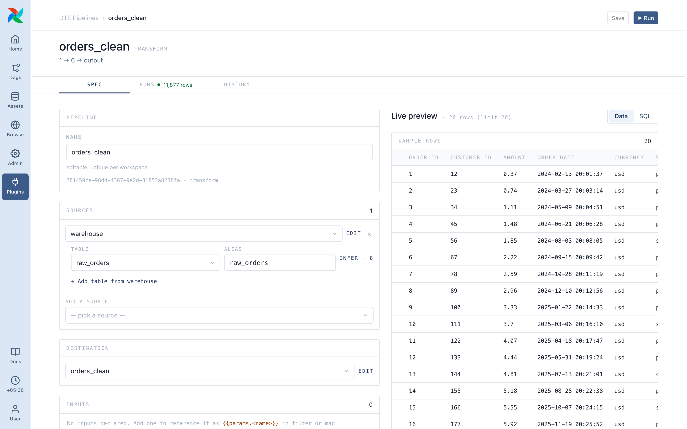

# Your first pipeline

Read a folder of orders, keep the paid ones, write them as JSON. You'll make a connection, a source, a destination and a pipeline.

## 1. Add a connection

**Admin ▸ Connections ▸ Add connection** in Airflow:

- Connection Id: `local`
- Connection Type: **File (path)** (`fs`)

The `fs` type needs no credentials. With the Docker Compose stack, `/tmp/dte-samples` is mounted for this.

## 2. Add a source

**Admin ▸ DTE Sources ▸ New**.

- Kind: **Filesystem**
- Connection: **local**
- Folder: `/tmp/dte-samples/` (a folder, not a file)
- Files: `orders.json`
- Format: leave blank to auto-detect

Click **Infer schema**. You should see columns like `id`, `customer`, `status` and `amount`.

## 3. Add a destination

**Admin ▸ DTE Destinations ▸ New**.

- Type: **JSON file**
- Connection: **local**
- Path: `/tmp/dte-samples/out/orders_paid.json`

## 4. Build the pipeline

**Plugins ▸ DTE Pipelines ▸ Transform ▸ New pipeline**.

- Name: **Paid orders**
- Pipeline type: **Transform**
- Sources: your orders source
- Destination: the one you just made

Add two steps:

1. **Filter**: *Basic* tab, field `status`, operator `=`, value `paid`
2. **Select / Drop fields**: mode **Keep**, tick `id`, `customer` and `amount`

Save. DTE gives the pipeline an id, and the dag-processor picks up `dte__<pipeline id>` within seconds.

## 5. Preview

The pipeline page shows a preview of the steps on a small sample: paid orders only, three columns. A red panel names what's wrong.

## 6. Run

Click **▶ Run** and confirm. The run goes `pending` → `running` → `completed` on the page, and your file is written. The same dag run is in Airflow with its task log.

To run it automatically, [add a schedule](../pipelines/scheduling.md).

## Next

- [Core ideas](03-concepts.md)
- [Steps reference](../steps/index.md)
