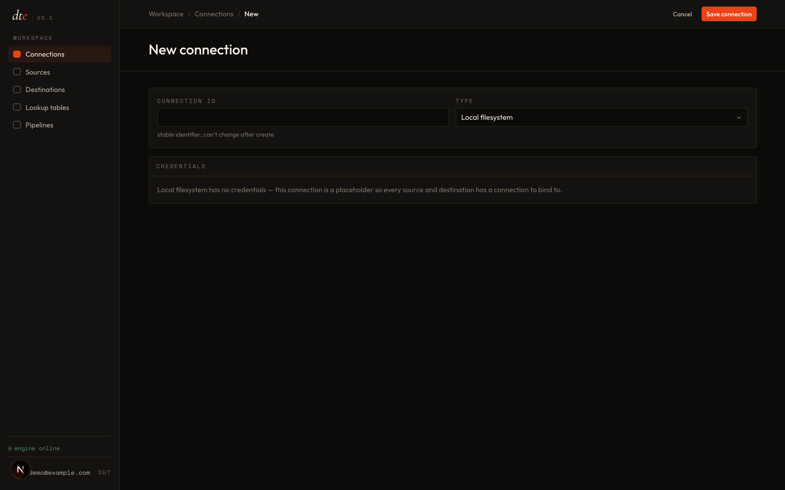
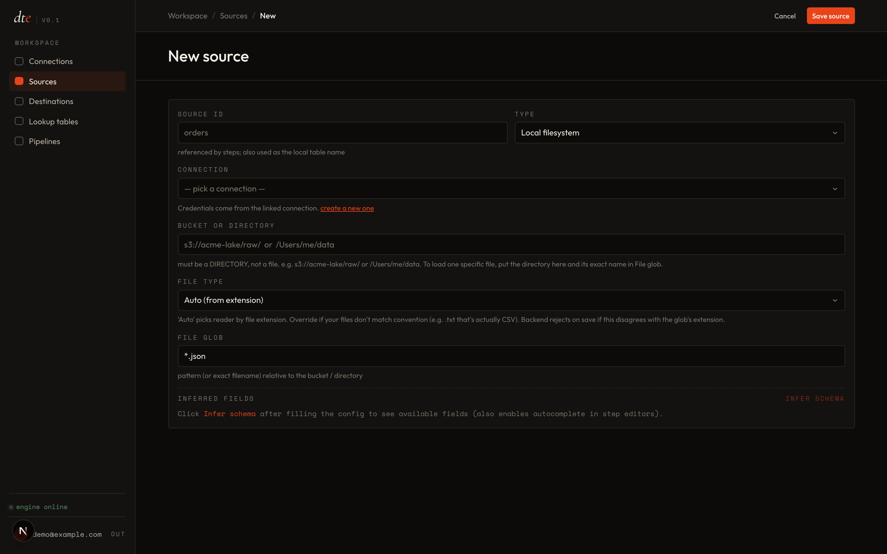
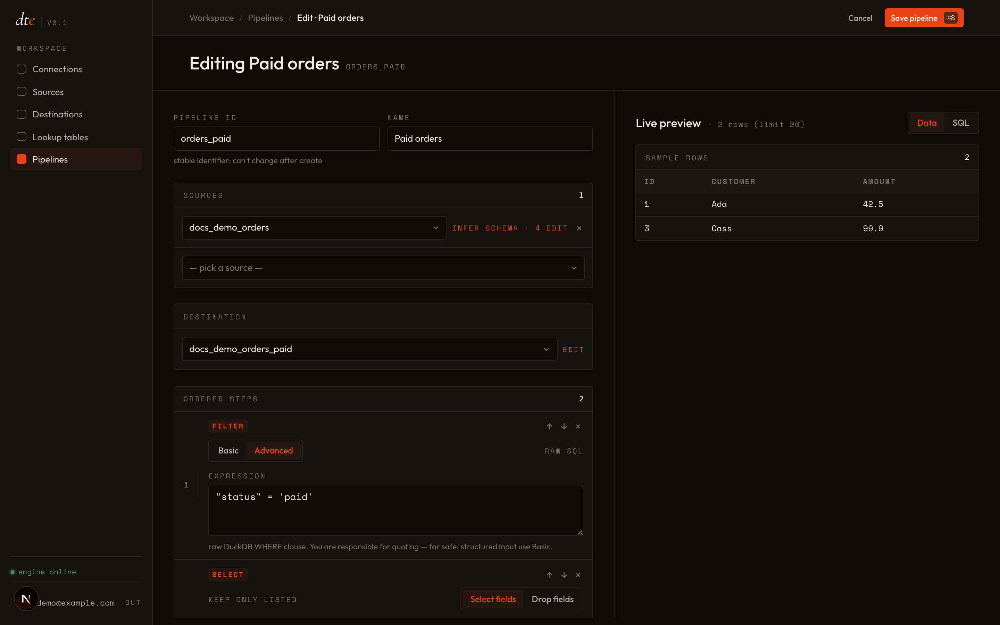

# Your first pipeline

Ten minutes. Read a folder of orders, keep only the paid ones, drop it as a clean JSON file.

You'll create one of each thing: a connection, a source, a destination, then a pipeline that uses them.

## 1. Add a connection

**Connections → New**. Pick **Local files** (no credentials needed). Give it a name — `local` is fine. Click **Test** — you'll see a green ✓. Save.

## 2. Add a source

**Sources → New**.

- Kind: **Filesystem**
- Connection: **local**
- Folder: `/data/`  (must be a folder, not a file)
- Files: `orders.json`
- Format: leave blank (dte will detect it)

Click **Infer schema**. dte reads a sample and shows the columns it found — `id`, `customer`, `status`, `amount`. If the schema doesn't look right, fix the folder or files field and try again.

## 3. Add a destination

**Destinations → New**.

- Type: **JSON file**
- Connection: **local**
- Path: `/data/out/orders_paid.json`

The extension has to match the type. If you type `.csv` here, the app will stop you at save.

## 4. Build the pipeline

**Pipelines → New**.

- Id: `orders_paid` (short, no spaces — this is used in run history)
- Name: **Paid orders**
- Sources: pick your orders source
- Destination: pick **orders_paid**

Add two steps:

1. **Filter** — on the *Basic* tab, choose field `status`, operator `=`, value `paid`
2. **Select** — mode **Keep**, tick `id`, `customer`, `amount`

Save.

## 5. Preview

Click **Preview** on the pipeline page. dte runs the recipe on a small sample and shows the result — you should see two rows and three columns.

If something's wrong, the preview panel goes red and tells you what. Fix the step, preview again.

## 6. Run

Click **Trigger**. dte starts the run and takes you to a page that refreshes every couple of seconds. When it turns green, your file is written.

That's it. You have a pipeline. Trigger it again tomorrow. Or the day after.

## Next

- [Core ideas](03-concepts.md)
- [Steps reference](../steps/index.md) — the other seven things you can do to data
