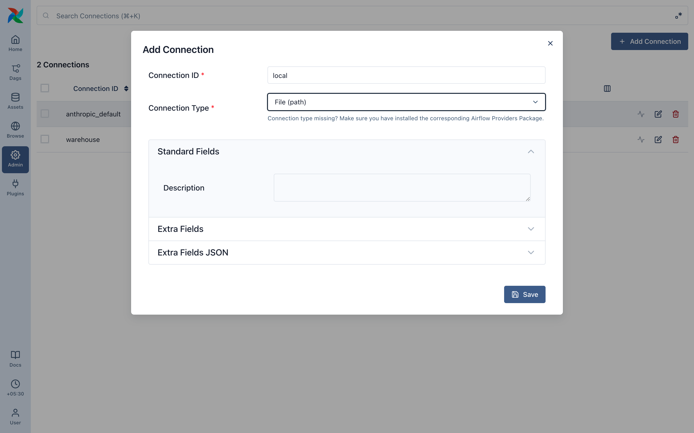
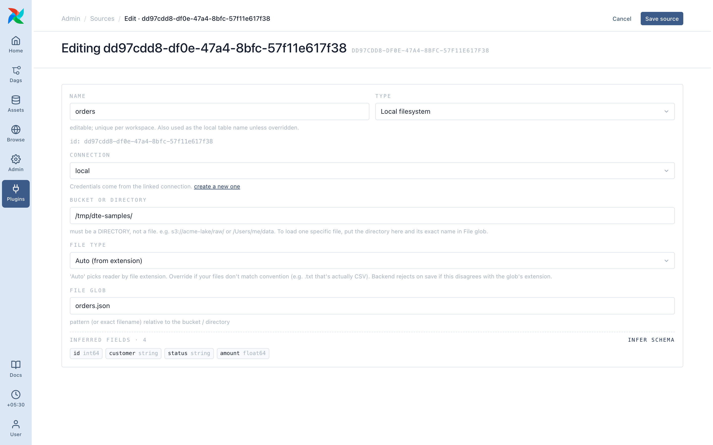
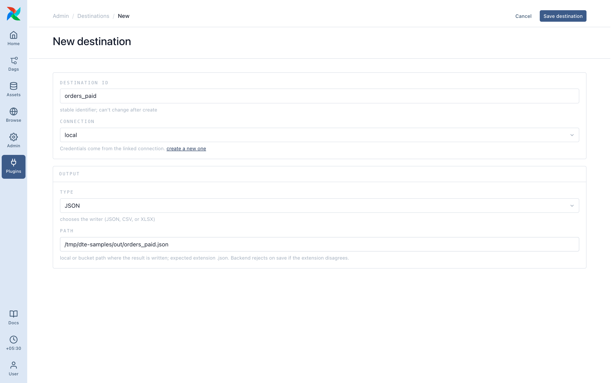
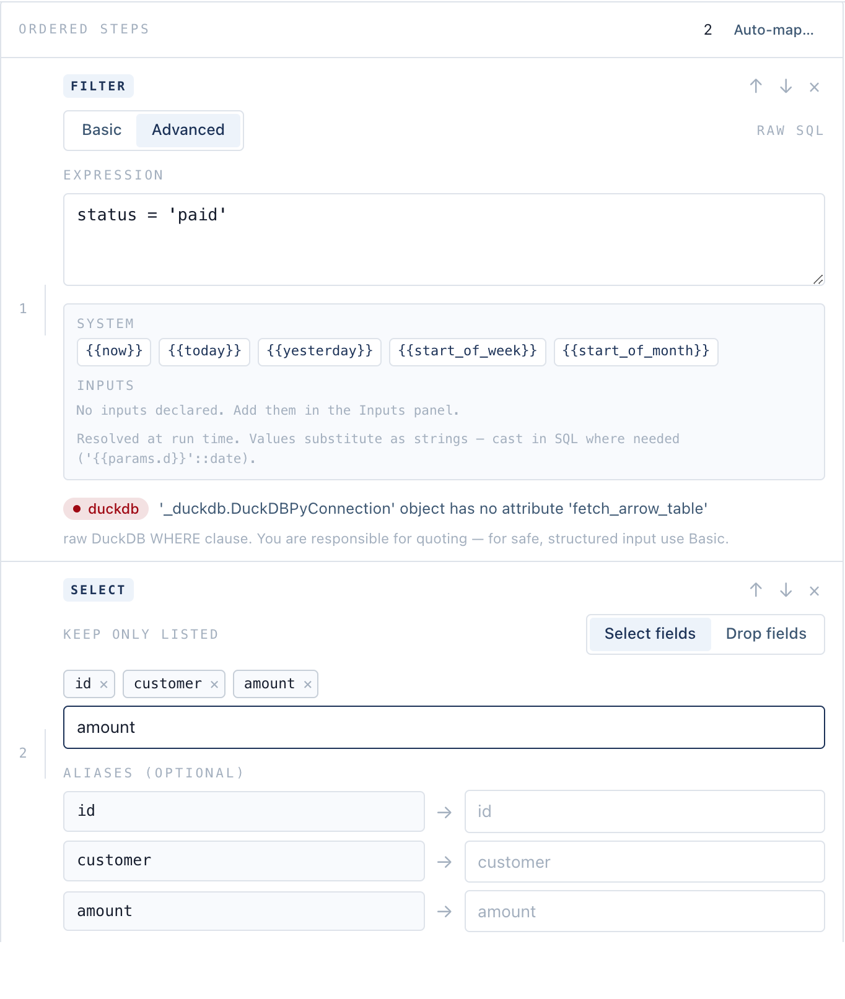

# Your first pipeline

Read a file of orders, keep the paid ones, write them as JSON. You'll make a connection, a source, a destination and a pipeline.

## 0. Sample data

With the Docker Compose stack, `/tmp/dte-samples` on your machine is mounted into Airflow at the same path:

```bash
mkdir -p /tmp/dte-samples && cat > /tmp/dte-samples/orders.json <<'EOF'
[
  {"id": 1, "customer": "Asha", "status": "paid",     "amount": 120.5},
  {"id": 2, "customer": "Ben",  "status": "pending",  "amount": 80.0},
  {"id": 3, "customer": "Chen", "status": "paid",     "amount": 42.0},
  {"id": 4, "customer": "Dara", "status": "refunded", "amount": 15.0},
  {"id": 5, "customer": "Eli",  "status": "paid",     "amount": 300.0}
]
EOF
```

## 1. Add a connection

**Admin ▸ Connections ▸ Add Connection**: Connection ID `local`, Connection Type **File (path)**. No credentials.



## 2. Add a source

**Admin ▸ DTE Sources ▸ New**:

- Name: `orders`
- Type: **Local filesystem**
- Connection: **local**
- Bucket or directory: `/tmp/dte-samples/` (a directory, not a file)
- File glob: `orders.json`

Save. **Infer schema** on the saved source lists `id`, `customer`, `status`, `amount`.



## 3. Add a destination

**Admin ▸ DTE Destinations ▸ New**: Destination id `orders_paid`, Connection **local**, Type **JSON**, Path `/tmp/dte-samples/out/orders_paid.json`.



## 4. Build the pipeline

**Plugins ▸ DTE Pipelines ▸ Transform ▸ New pipeline**. Name **Paid orders**, type **Transform**, source `orders`, destination `orders_paid`. Then **+ Add step**:

1. **Filter** ▸ **Advanced**: `status = 'paid'`
2. **Select / Drop fields** ▸ **Select fields**: `id`, `customer`, `amount`



Save. DTE gives the pipeline an id, and the dag-processor picks up `dte__<pipeline id>` within seconds.

## 5. Preview

The live preview on the right runs the steps on a sample as you edit: three paid orders, three columns. A red panel names what's wrong.


## 6. Run

Click **▶ Run** and confirm. The run goes `pending` → `running` → `completed` on the page, and `/tmp/dte-samples/out/orders_paid.json` is written. The same dag run is in Airflow with its task log.


To run it automatically, [add a schedule](../pipelines/scheduling.md).

## Next

- [Core ideas](03-concepts.md)
- [Steps reference](../steps/index.md)
