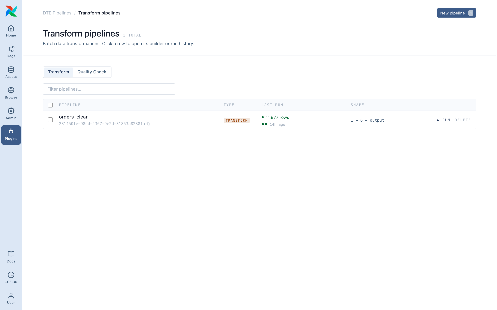
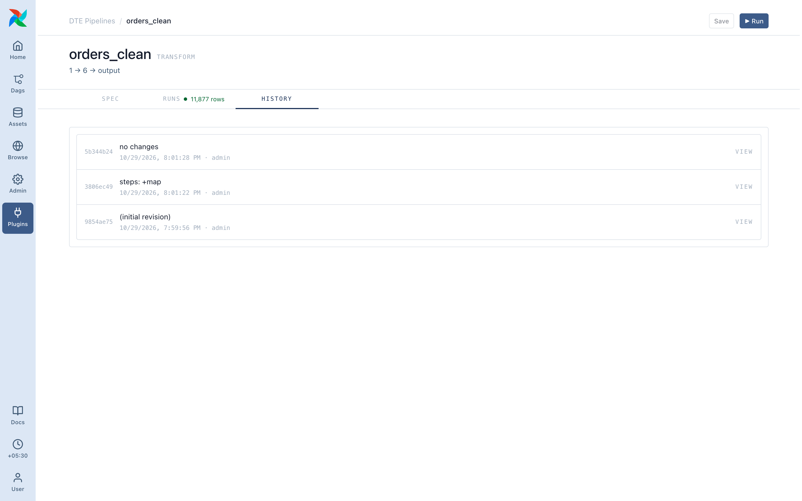

# Building a pipeline

**Plugins ▸ DTE Pipelines ▸ Transform**, then **New pipeline**.

## The form

The id is generated on save and names the DAG: `dte__<id>`.

- Name: required, unique, editable any time.
- Pipeline type: **Transform** writes output; **Quality Check** asserts conditions on it.
- Sources: at least one, saved or added inline.
- Destination: exactly one, saved or added inline.
- Steps: zero or more, in order.

Save is blocked until name, a source and a destination are set, and every **Select / Drop fields** step has at least one field.

## Sources

One card per source. Reorder with ↑/↓, remove with x, add with **+ New source**. **Edit** opens the source inline; sources are shared, so the edit affects every pipeline using it.

dte infers each source's schema as you build. If a field picker is empty, click **Infer schema** on the card.

## Destination

Same shape as a source card, one value. JSON file destinations edit inline; other types live under **Admin ▸ DTE Destinations**.

## Steps

**Add step** opens a menu of every op ([Steps](../steps/index.md)). Reorder with ↑/↓, remove with x.

For a database destination, **Auto-map** proposes a mapping from source fields to the target table's columns. Tick the matches and it adds one ordinary **Select / Drop fields** step.

## Save and revisions

**Save** checks that sources and destination exist and match their connections, and that no step is obviously broken. Errors show in a red panel naming the field.

Every save is a new **revision** on the **History** tab, and the dag-processor picks it up in seconds. Each run records the revision it ran.

See also: [Preview & run](preview-and-run.md), [Scheduling](scheduling.md), [Field names](field-refs.md), [Lookup tables](lookup-tables.md).
