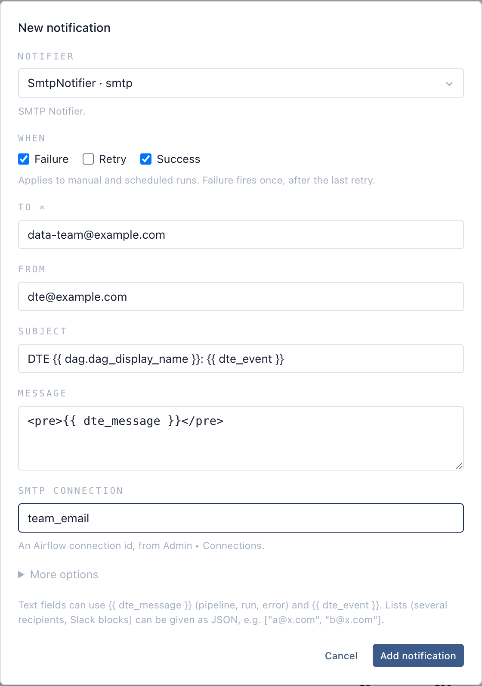
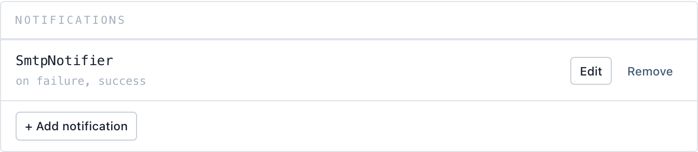
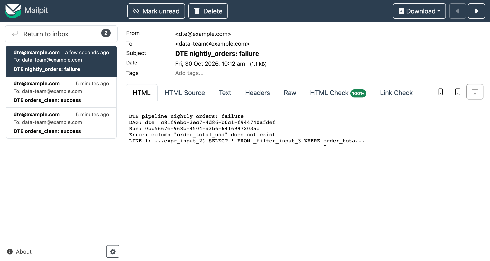

# Notifications

A pipeline can notify people when its runs fail, retry or succeed. Notifications belong to
the pipeline, not its schedule, so manual runs and scheduled runs both send them.

## Adding one

On the pipeline page, open **Notifications ▸ Add notification**:



1. **Notifier**: any notifier offered by an Airflow provider installed in your deployment.
   The stock image has Slack, Slack webhook, SMTP email, Amazon SES, SNS, SQS and Chime, and
   Microsoft Graph. The list comes from Airflow, so installing a provider package (Discord,
   PagerDuty, Opsgenie, Apprise, …) adds its notifiers with no DTE change.
2. **When**: any of *Failure*, *Retry*, *Success*. *Failure* fires once, after the last
   retry has failed.
3. **The notifier's arguments**, one field each. Required ones are marked `*`; rarely used
   ones sit under **More options**. Picking a notifier fills the message with
   `{{ dte_message }}` (and an email's subject with the pipeline and event), so usually you
   only add the recipient and the connection. A field that takes a list (several
   recipients, Slack blocks) accepts JSON, e.g. `["a@x.com", "b@x.com"]`.

Most notifiers take an Airflow connection id (`slack_conn_id`, `smtp_conn_id`, …). Create
the connection in Airflow under **Admin ▸ Connections** first.

The saved notification shows in the panel with the events it fires on:



### Email

Create an **SMTP** connection (`team_email` here) with your mail server's host, port, login
and password, then pick **SmtpNotifier** and fill in **To**, **From** and **SMTP
connection** (`team_email`), as in the form above. Subject and message come prefilled.

A failed run sends the pipeline, its DAG, the run and the error:



### Slack

Create a **Slack Incoming Webhook** connection (`ops_slack`) with the webhook URL as its
password, then pick **SlackWebhookNotifier** and set **Slack webhook connection** to
`ops_slack`. The message comes prefilled.

With a Slack app token instead, use a **Slack API** connection and **SlackNotifier**, which
also takes a `channel`.

Fields the notifier templates (message, subject, …) can use these values:

| Value | Contains |
|---|---|
| `{{ dte_message }}` | the pipeline, its DAG, the run id and, on failure or retry, the error |
| `{{ dte_event }}` | `failure`, `retry` or `success` |

Airflow's usual template context (`{{ run_id }}`, `{{ dag.dag_id }}`, …) works too.

## Checked when you save

DTE refuses a notification, naming the problem, when:
- the notifier isn't one an installed provider registers,
- the parameters don't fit its arguments (a required one missing, an unknown one given), or
- a `*_conn_id` parameter names an Airflow connection that doesn't exist.

Whether the message actually arrives (a valid token, a channel the bot can post to) is only
known when it sends. A notification that fails to send is logged in the task log and never
changes the run's own outcome.

## API

```
GET /dte/api/notifiers                          installed notifiers and their arguments
GET /dte/api/pipelines/{id}/notifications       the pipeline's notifications
PUT /dte/api/pipelines/{id}/notifications       replace them: [{notifier, params, on}]
```

Notifications are also the `notifications` field of the pipeline; a pipeline `PUT` that omits
it keeps the current ones. Every change is a pipeline revision.
