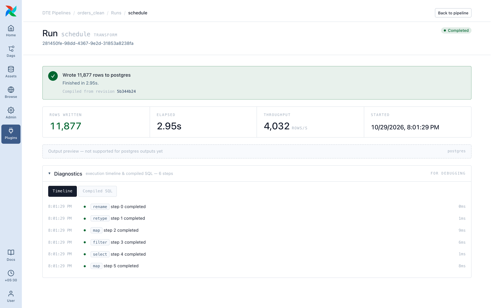
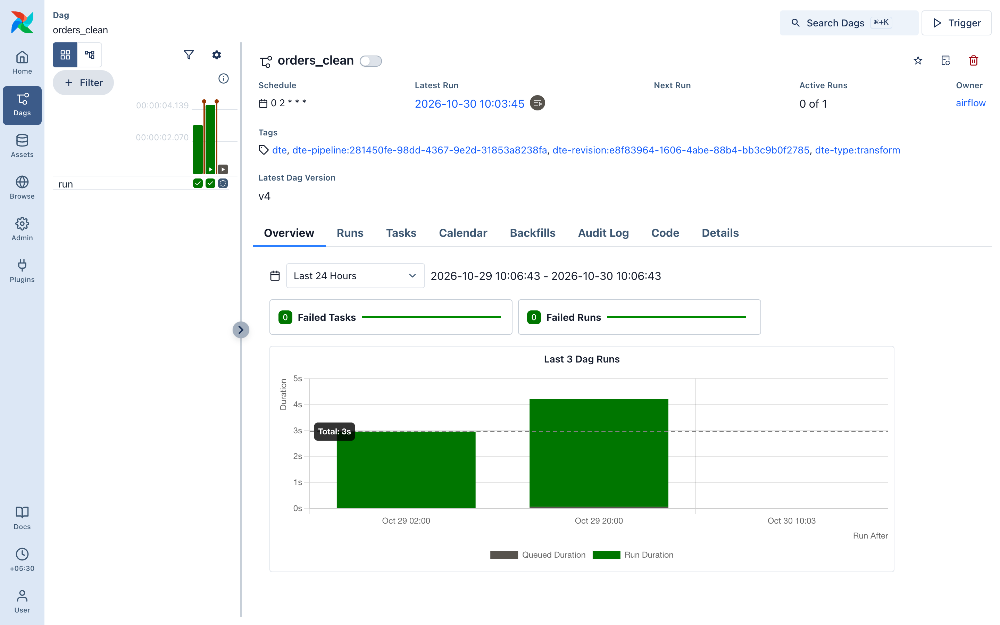
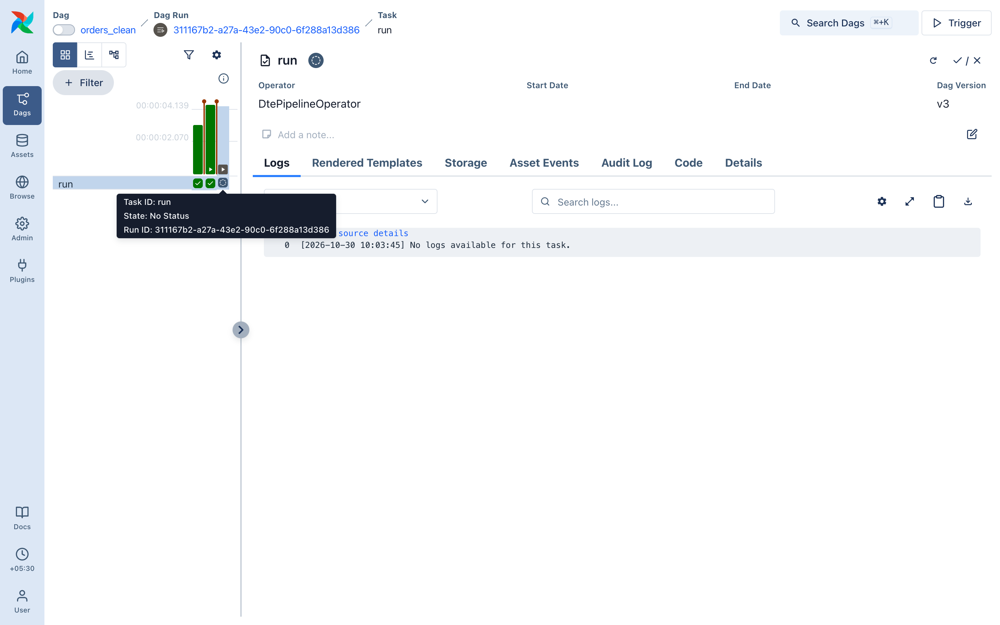

# Preview & run

## Preview

Runs your steps on a sample and shows a table.

- Reads sources, never writes to a destination.
- Capped at about 20 rows: shape, not totals.
- A broken step (bad cast, missing field, invalid filter) turns the panel red with the error.
- Runs in Airflow's api-server, not as a task, so it isn't in run history.

## Run

**▶ Run** starts an Airflow dag run of `dte__<pipeline id>`, asking for parameters first if the pipeline declares any. It appears on the pipeline page straight away and refreshes every couple of seconds.

A run shows:

- Status: `pending` → `running` → `completed` or `failed` (see [run statuses](../getting-started/03-concepts.md#run))
- Rows written, elapsed, started
- Trigger params, if any
- Quality checks, each passed or failed
- On failure, the full error

For file destinations the page also shows the first rows of the written file.

The same dag run is in Airflow under `dte__<pipeline id>` (filter by the `dte` tag), with the task log.

## Cancel

No cancel button yet. Mark the dag run failed in Airflow, or call `POST /dte/api/runs/{run_id}/cancel`.

## Run history

The **Runs** tab lists every run, marked **Manual** or **Scheduled**.
