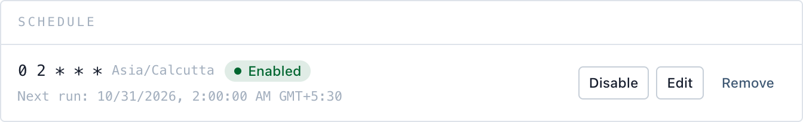

# Scheduling

Airflow does the scheduling. A pipeline is one DAG, `dte__<pipeline id>`, and has at most one schedule: that DAG's cron, the outputs of the pipelines it waits on, or new messages on its Kafka sources. Manual and scheduled runs share the DAG, run history and logs.

The schedule is part of the pipeline, so changing it is a new revision (and a new Airflow DAG version). Each run records the revision it started against.

## Creating one

Open a pipeline, find the **Schedule** panel, choose **Set schedule**.



| | Meaning |
| --- | --- |
| **Hourly** | Every hour, at the minute you choose |
| **Daily** | Once a day, at the time you choose |
| **Weekly** | Once a week, on the day and time you choose |
| **Custom** | A standard 5-field cron expression, e.g. `0 2 * * 1-5` |

These are the **On a timer** trigger. The others are **After upstream** (see [Chaining](#chaining)) and **On new messages** (see [On new messages](#on-new-messages)).

The DAG picks up the cron on the next dag-processor parse.

### Timezone

Defaults to **your browser's timezone**, not UTC. Airflow's cron timetable handles DST.

### Parameters

A required parameter with no default must get a value here; the schedule is rejected at save otherwise.

`{{now}}`, `{{today}}`, `{{yesterday}}`, `{{start_of_week}}` and `{{start_of_month}}` resolve to the run's **scheduled time** in the schedule's timezone, not the time the task happens to start. A 2am run that starts late, retries, or is cleared and re-run next week still processes the same day. Manual runs use the time you click Run.

## Checking it

The panel shows the **next run time**. Scheduled runs are marked **Scheduled** in the run list, and the DAG is in Airflow (tag `dte`).

## Rules

- Missed runs aren't made up (`catchup=False`).
- One run at a time by default, scheduled or not: two runs writing the same destination at once is never what you want. **Overlap** *Skip* sets `max_active_runs=1`, and a pipeline with no schedule gets it too. Manual runs share the DAG, so a manual trigger queues behind a running one. Set *Allow* if concurrent runs are safe.
- Disabling keeps the schedule and leaves the DAG manual-only. Deleting a pipeline deletes its schedule.

## Failures

A failed run lands in run history with the error. The schedule's retry settings apply to every run of the pipeline, manual ones included:

- **Retries** (default 0) and **Retry after**: errors like an unreachable bucket or a dropped connection are retried. A failed `fail`-severity quality check, or a missing source or destination, never is. Retries are refused on **append** destinations: a retry after a partial write would duplicate rows.
- **Timeout**: a run that takes longer is failed (and retried, if retries are set). Unset, it's 30 minutes (`DTE_RUN_TIMEOUT_SECONDS`).

To hear about failures (or successes), add a [notification](notifications.md). Notifications belong to the pipeline, not the schedule, so manual runs notify too.

## API

```
GET    /dte/api/pipelines/{id}/schedule    read (null when unscheduled)
PUT    /dte/api/pipelines/{id}/schedule    set or replace
DELETE /dte/api/pipelines/{id}/schedule    remove
```

Body: `mode` (`cron` | `assets` | `messages`, default `cron`), `cron_expr` (cron mode), `assets` (assets mode: upstream URIs from `GET /dte/api/assets`), `timezone`, `params`, `enabled`, `overlap` (`skip` | `allow`), `retries` (0–10), `retry_delay_s`, `timeout_s`, and `eval_set_id` for eval pipelines. The schedule is also the `schedule` field of the pipeline; a pipeline `PUT` that omits it keeps the current one. A bad cron, unknown timezone, missing required parameter, retries on an append destination, or a `messages` schedule with no Kafka source or with `overlap: allow` returns 422 with the reason.

## Chaining

"Run B after A": give B the **After upstream** trigger and tick A. B runs whenever a successful run of A updates its output. Tick several and B waits for all of them, not any: each must have updated since B's last run.

This is Airflow's data-aware scheduling. Every pipeline's `run` task declares its sources as inlets and its destination as an outlet [Asset](https://airflow.apache.org/docs/apache-airflow/stable/authoring-and-scheduling/asset-scheduling.html), so Airflow's **Assets** view is the lineage graph across pipelines. URIs:

| What | Asset URI |
| --- | --- |
| Database table (destination or `sql_database` source) | `dte://<conn_id>/<schema>/<table>` |
| MongoDB collection | `dte://<conn_id>/<database>/<collection>` |
| Kafka topic | `dte://<conn_id>/kafka/<topic>` |
| Local file | `file:///<path>` |
| Object storage | the configured URL, e.g. `s3://bucket/key` |

A table read and written through the same connection id gets the same URI, which is what links the two pipelines. URIs carry the connection id, never credentials. REST API sources have no Asset.

With [pipelines in git](in-git.md) (`DTE_PIPELINE_STORE=file`), pipelines don't declare Assets yet, so an **After upstream** or **On new messages** schedule never fires. Use cron there for now.

## On new messages

For a pipeline that reads a [Kafka source](../sources/kafka.md): it runs whenever any of its Kafka sources has messages it hasn't read yet. No messages, no runs. See [Kafka: run on new messages](../sources/kafka.md#run-on-new-messages) for how it works and what it costs.

Needs an Airflow **triggerer** running (the Compose stack has one). Overlap is always *Skip*.
