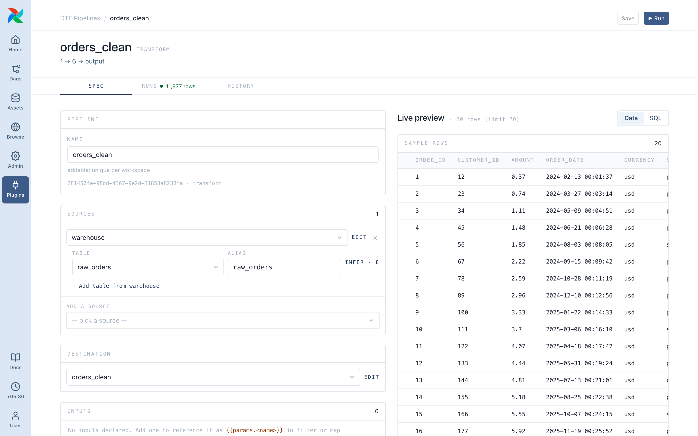
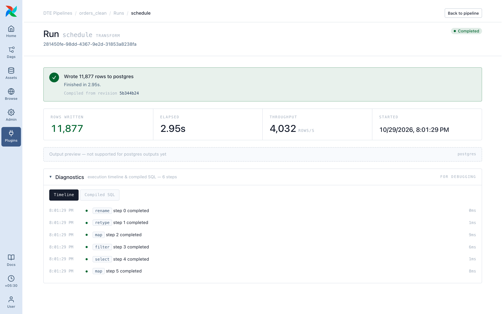
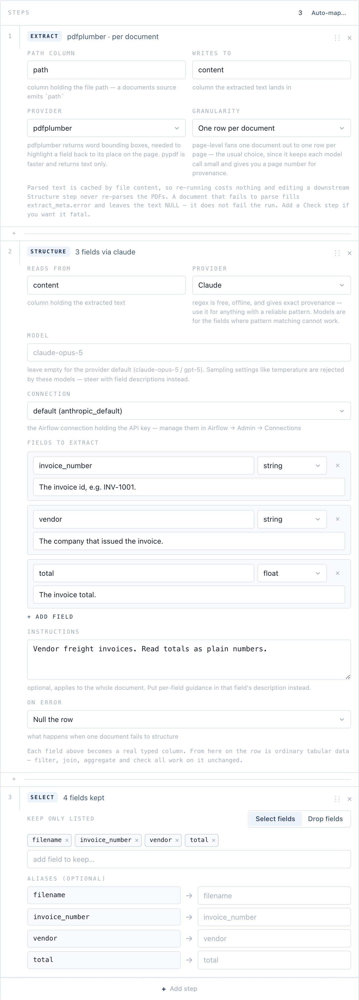
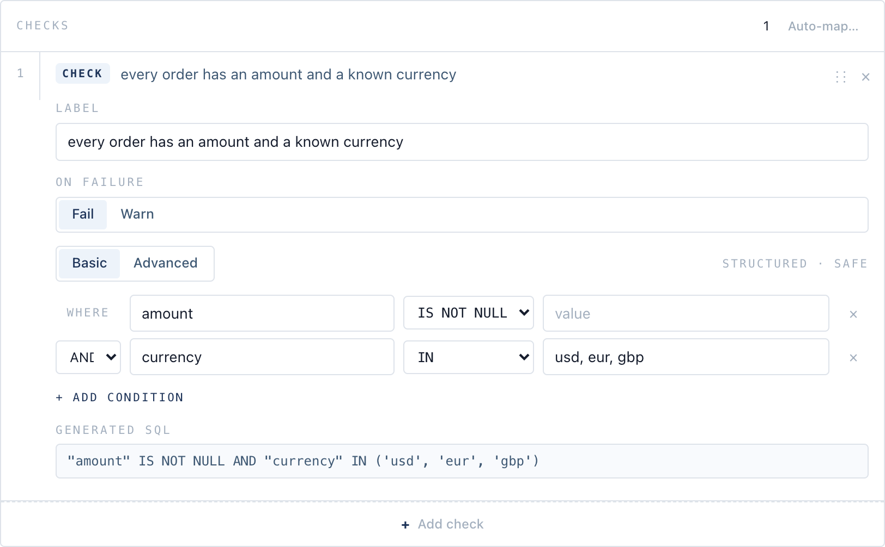
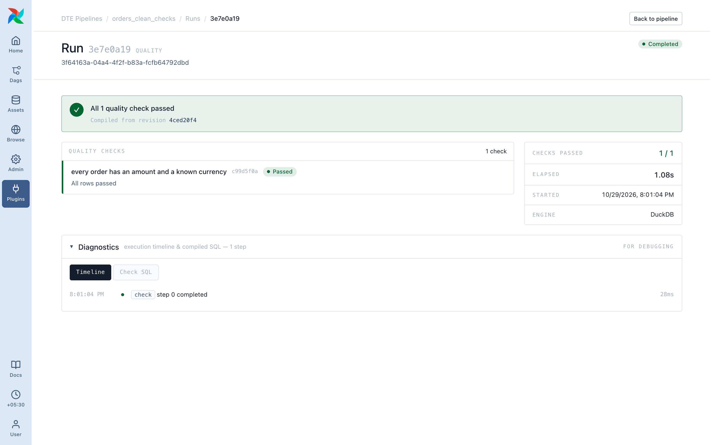

# Pipeline types

Pick the type when you create a pipeline. **Plugins ▸ DTE Pipelines** has a tab for each.

| Type | Reads | Writes | Use it to |
|---|---|---|---|
| [Transform](#transform) | Any source | One destination | Clean, reshape, join and load data |
| [Extract](#extract) | PDF documents | One destination | Turn documents into typed rows |
| [Quality Check](#quality-check) | Any source | Nothing | Assert rules about data, fail or warn |

## Transform

Sources → steps → one destination. Most pipelines are this.



A run reports rows written, time taken and the steps it ran.



Walkthrough: [Your first pipeline](../getting-started/02-first-pipeline.md).

Every step except **Check** and **Profile Columns** is allowed; saving a Transform with either returns an error. To check data, use a [Quality Check](#quality-check) pipeline or a quality contract.

### Quality contracts

A Transform can carry `quality_contracts`: rules on its result (`row_count_between`, `column_not_null`, `column_unique`, `column_in_range`, `column_matches`), each with a severity, set through the API or the [pipeline file](in-git.md). There's no editor for them yet.

- `phase: pre` (the default) checks the result **before** the write. A failing `fail` contract ends the run as `failed_quality` and writes nothing, so the destination keeps its last good data.
- `phase: post` checks the destination after the write, for rules that need the written table. A failure there is reported, but the rows are already written.

```yaml
quality_contracts:
  - {type: column_not_null, id: amount_set, column: amount, severity: fail}
  - {type: row_count_between, id: sane_size, min: 1, max: 1000000, severity: warn, phase: post}
```

## Extract

A Transform pipeline on a **Documents** source, a folder of PDFs. Two steps do the work:

1. **Extract text**: each PDF becomes text, one row per document or per page.
2. **Structure fields**: the text becomes the columns you declare (`invoice_number`, `vendor`, `total`), read by Claude or OpenAI through an Airflow connection, or by regex rules offline.

From there it's ordinary rows: filter, join and check them like any other table.



Parsed text and model answers are cached by content, so re-running or editing later steps doesn't pay twice. Needs the `unstructured` and `models` extras. Step details: [Documents (PDF)](../steps/index.md#documents-pdf).

## Quality Check

Sources → **Check** steps. No destination; it writes nothing.

Besides **Check** and **Profile Columns**, it can only **Filter**, **Rename**, **Select** and **Join**, enough to narrow what's checked.

Each check has a label, a condition (Basic rules or SQL) and what a failure means: **Fail** ends the run as `failed_quality`, **Warn** as `completed_with_warnings`.



The run lists each check, passed or failed.



Point one at a Transform's destination table and schedule it [after that pipeline](scheduling.md#chaining) to check every load. It runs after the write, so to stop bad rows from landing at all, use a `pre` [quality contract](#quality-contracts) on the Transform.
