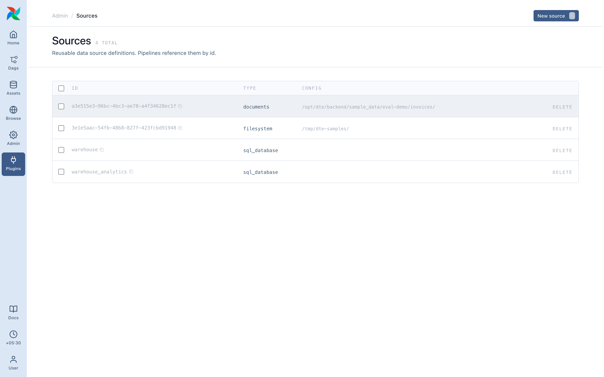
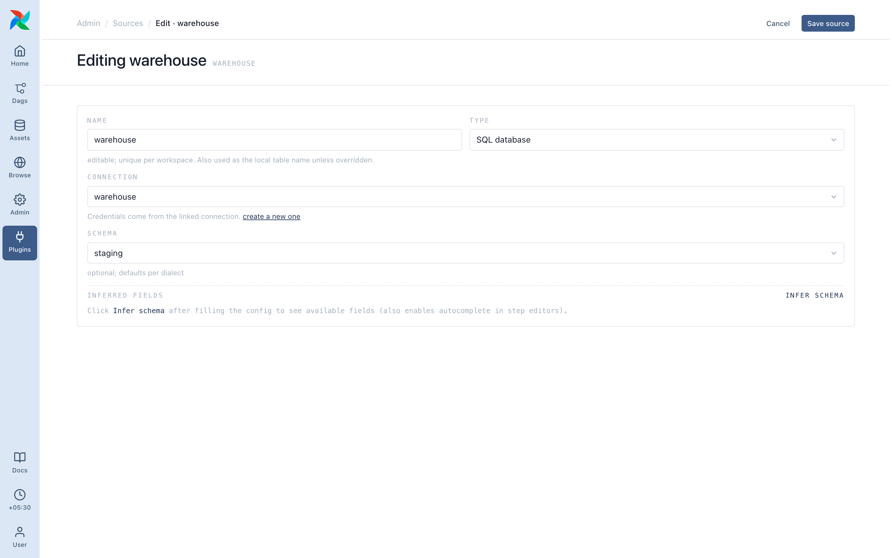

# Sources

A source is where inside a system your data lives: a [connection](../connections/index.md) plus details. Kinds follow the installed Airflow providers; a kind with a missing provider shows disabled with the package to install.

## Every source kind

| Kind | Use for | What you fill in |
| ---- | ------- | ---------------- |
| **Filesystem** | Files on the machine dte runs on | Folder, file pattern (e.g. `orders*.json`), optional format |
| **Amazon S3** | Objects in an S3 bucket | Bucket URL (`s3://bucket/path/`), file pattern, optional format |
| **Google Cloud Storage** | Objects in a GCS bucket | Bucket URL (`gs://bucket/path/`), file pattern, optional format |
| **Azure Blob Storage** | Blobs in an Azure container | Bucket URL (`az://container/path/` or `abfs://container/path/`), file pattern, optional format |
| **SFTP** | Files on an SFTP server | Folder URL (`sftp:///path/on/server/`, the host comes from the connection), file pattern, optional format |
| **SQL database** | A table (or a custom query) in Postgres, MySQL, SQL Server, SQLite, Snowflake, or BigQuery ([BigQuery guide](bigquery.md): setup and cost) | Either **Table** name or a **Query**, not both |
| **MongoDB** | A collection | Database name, collection name |
| **REST API** | Data from a JSON API | Endpoint path, pagination shape, resource details |

## Folders and patterns

The folder field is a folder, not a file. The pattern picks files in it: `orders*.json` matches files starting with `orders`; `**/*.json` matches `.json` files in every subfolder.

## File format

Guessed from the extension. Override with **Format**:

- `json`, `jsonl`, `ndjson`
- `csv`, `tsv`
- `parquet`
- `excel` (`.xlsx`, first sheet only)

A format from a different family than the pattern is refused at save (`*.csv` with `excel`). Same family is allowed (`*.json` with `jsonl`), for wrong extension, right content.

## Infer schema

Every source form has an **Infer schema** button. It reads a small sample and shows the columns, including nested ones (`order.amount`, `user.address.city`). Filter fields, rename mappings and select checkboxes all fill in from it.

## Shared sources

Editing a source affects every pipeline that reads it; the form says so. Deleting one in use lists the pipelines that depend on it.
