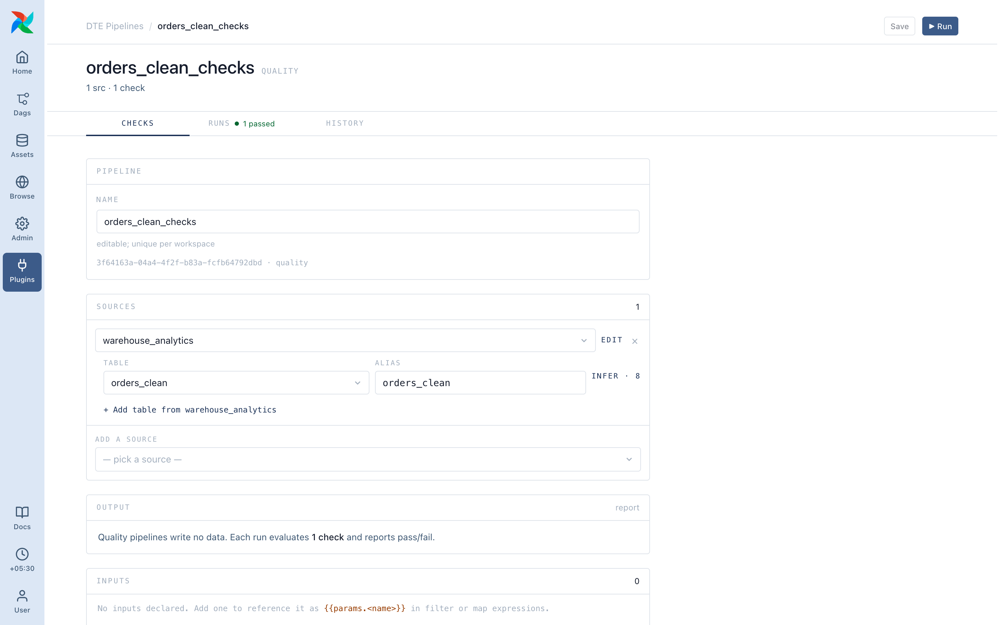

# Steps

Each step reads the current data, changes it and hands it to the next, so order matters.

## Transform

| Step | What it does | You fill in | Handy for |
| ---- | ------------ | ----------- | --------- |
| **Filter** | Keeps rows matching a condition | On the *Basic* tab: a field, an operator (`=`, `>`, `<`, `in`, `is null`…), a value | Dropping cancelled orders, keeping last-30-days rows |
| **Rename** | Renames columns | A list of `new name` ← `old name` | Cleaning up ugly source column names |
| **Retype** | Changes a column's type | Field, target type (`string`, `int`, `float`, `bool`, `date`, `timestamp`) | Turning a text price into a number |
| **Map · lookup** | Looks up a value in a small [lookup table](../pipelines/lookup-tables.md) | Field to look up, lookup table, output column | Country code → country name |
| **Map · expression** | Calculates a new column | Output name, expression (a small SQL formula) | `amount * 1.1`, `upper(name)` |
| **Case · if/else** | Sets a column from conditions, first match wins | Branches of *when … then …*, plus an *otherwise* value | Banding amounts into `small` / `medium` / `large` |
| **Sort** | Orders the rows | Fields to sort by, ascending/descending | Newest first |
| **Aggregate** | Groups rows and summarises | Group-by fields, aggregations (sum, count, avg, min, max) | Total revenue per customer per month |
| **Join** | Combines two sources on a matching column | Left source, right source, join column, join type (`inner`, `left`, `right`, `outer`) | Enrich orders with customer details |
| **Pivot** | Turns rows into columns | Row field, column field, value field, aggregation | Monthly sales as one column per month |
| **Select / Drop fields** | Keeps or drops columns | A list of fields, mode **Keep** (with optional aliases) or **Drop** | Keeping a handful of columns; hiding PII |

## Quality

| Step | What it does | You fill in |
| ---- | ------------ | ----------- |
| **Check** | Asserts something about every row: `amount >= 0`, `email is not null` | A condition, a label, and a severity: **fail** fails the run (`failed_quality`), **warn** finishes it as `completed_with_warnings` |
| **Profile Columns** | Records per-column stats: null count, distinct count, min, max | The columns to profile |

These steps belong to **Quality Check** pipelines only (**Plugins ▸ DTE Pipelines ▸ Quality Check**), which check a source and write nothing; a Transform with one is refused at save. A Quality Check pipeline can also Filter, Rename, Select and Join, but nothing else. See [Pipeline types](../pipelines/types.md).

## Documents (PDF)

For a **Documents** source, which lists PDF files:

| Step | What it does |
| ---- | ------------ |
| **Extract text** | Turns each document into text, one row per page or per document. A file that can't be parsed gets an error in its row instead of failing the run. |
| **Structure fields** | Turns text into the typed columns you declare (`invoice_number`, `total`…). It uses Claude or OpenAI through an `anthropic` / `openai` Airflow connection, or regex rules that run offline. |

Results are cached by content. These steps need the `unstructured` and `models` extras ([install](../self-hosting/install-plugin.md)).

## Filter and Check tabs

- Basic: field, operator, value; dte handles quoting.
- Advanced: a raw SQL condition in DuckDB SQL. For a database source dte translates it to that dialect and tells you under the input if it will read differently. Use Basic unless you need more.

## Aggregate: date parts

Group a date or timestamp field by a part of it:

| Part | Example |
| ---- | ------- |
| `year` | 2026 |
| `quarter` | 2 |
| `month` | 7 |
| `week` | 30 |
| `day` | 29 |
| `date` | 2026-07-29 |
| `dow` (day of week) | 3 |
| `hour` | 14 |

## Join: where the result goes

Join writes to a **named** result instead of the running dataset. You give it an **Output id**, and later steps choose which result to read, including the join result. This is how multi-source pipelines work.
